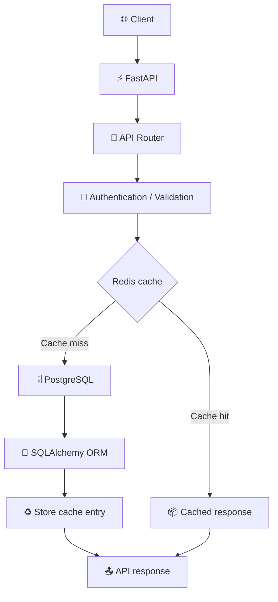
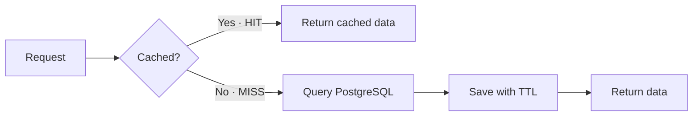

<div align="center">


<p>
  
</p>

<p>
  <strong>A centralized REST API for discovering and managing OTT content.</strong><br/>
  Explore titles, genres, streaming platforms, watchlists, and favorites through one backend service.
</p>

<p>
  
  
  
  
</p>
<p>
  
  
  
  
</p>

</div>

---

## 🎬 The idea

Finding something to watch shouldn't mean jumping between multiple streaming apps. **OTT Content Aggregator API** provides a unified backend for organizing and discovering movies and TV shows, with authentication, user collections, and caching built into the service.

> **Project focus:** modular REST API development, relational data management, secure authentication, and faster repeated reads through Redis.

## ✨ What the API offers

<table>
<tr>
<td width="50%" valign="top">

### 🎞️ Content discovery
- Public title discovery endpoints
- Organized genres and streaming platforms
- Structured movie and TV-show records
- Search and filtering foundation

</td>
<td width="50%" valign="top">

### 🔐 User accounts
- JWT-based authentication
- Password hashing
- User profile management
- Protected endpoints

</td>
</tr>
<tr>
<td width="50%" valign="top">

### ❤️ Personal collections
- Private watchlists
- Favorites management
- User-specific protected data
- Consistent request validation

</td>
<td width="50%" valign="top">

### ⚡ Performance & operations
- Redis-backed title response caching
- Cache expiration and invalidation
- `/health` and `/ready` probes
- PostgreSQL persistence through SQLAlchemy

</td>
</tr>
</table>

## 🧭 How a request travels



The exact path depends on the endpoint. Public discovery requests can use the caching layer; protected user operations also pass through authentication and authorization checks.

## 🧰 Technology stack

| Technology | Role |
|---|---|
| **Python 3.10+** | Backend language |
| **FastAPI** | REST API framework |
| **PostgreSQL** | Relational database |
| **SQLAlchemy 2.0** | ORM and database access |
| **Pydantic v2** | Request and response validation |
| **Redis** | Frequently accessed response cache |
| **python-jose / JWT** | Token-based authentication |
| **Passlib** | Password hashing |
| **Alembic** | Database migrations |
| **Pytest + HTTPX** | API testing |
| **Uvicorn** | ASGI server |

## 🚀 Run it locally

### Prerequisites

- Python 3.10 or newer
- PostgreSQL
- Redis
- Git

### 1. Clone the repository

```bash
git clone <YOUR_GITHUB_REPOSITORY_URL>
cd ott-aggregator-api
```

### 2. Create and activate a virtual environment

```bash
python -m venv venv

# macOS / Linux
source venv/bin/activate

# Windows
# venv\Scripts\activate
```

### 3. Install dependencies

```bash
pip install -r requirements.txt
```

### 4. Configure environment variables

Create a `.env` file in the project root and add the values required by your application configuration.

```env
DATABASE_URL=<YOUR_POSTGRESQL_CONNECTION_STRING>
REDIS_URL=redis://localhost:6379/0
SECRET_KEY=<YOUR_SECRET_KEY>
```

Use the exact variable names expected by the project's settings. Keep `.env` private and never commit secrets.

### 5. Apply database migrations

```bash
alembic upgrade head
```

### 6. Start Redis and launch the API

Make sure your Redis server and PostgreSQL service are running. Then start the application using the entry point configured in your repository. For an `app/main.py` entry point:

```bash
uvicorn app.main:app --reload
```

### 7. Open the API documentation

| Resource | Local URL |
|---|---|
| Swagger UI | http://127.0.0.1:8000/docs |
| ReDoc | http://127.0.0.1:8000/redoc |

*If your repository uses a different Uvicorn import path or migration setup, use the commands defined by that implementation.*

## ⚡ Why Redis?

For frequently requested title data, the cache can avoid repeating the same database read on every request.



- **GET** — retrieve a cached response.
- **SET** — store a response with an expiry time (TTL).
- **DELETE** — invalidate a cached entry when underlying data changes.

Cache invalidation matters: when a title is changed, related cached data should not remain stale.

## 🛡️ Security

- JWT-based authentication for protected routes
- Password hashing rather than storing plain-text passwords
- Request validation with Pydantic
- Environment-based configuration for secrets
- Authorization checks for user-specific resources

Never publish database credentials, secret keys, access tokens, or `.env` files.

## 🩺 Health checks

The service includes operational probes:

- `/health` — health endpoint
- `/ready` — readiness endpoint

Use these endpoints to check service health and readiness during local development or deployment.

## 🧪 Testing

The project uses Pytest and HTTPX as its testing tools.

```bash
pytest
```

For verbose output:

```bash
pytest -v
```

Useful areas to cover include authentication, protected routes, title discovery, database operations, cache behavior, validation, and error handling.

## 🗺️ Development status

The implementation summary below reflects the current project description. Check the route documentation and codebase for the precise request/response schema of each endpoint.

| Area | Current status |
|---|---|
| JWT authentication | Implemented |
| User profile management | Implemented |
| Admin-managed titles, genres & platforms | Implemented |
| Public title discovery | Implemented |
| Private watchlists & favorites | Implemented |
| Redis-backed title response caching | Implemented |
| `/health` and `/ready` probes | Implemented |
| External provider integrations | Not claimed by this project description |

### Next improvements

- Expand automated endpoint and integration test coverage
- Improve API logging and monitoring
- Continue performance and cache-behavior testing
- Add external streaming-provider integrations when credentials, APIs, and requirements are available

## 🤝 Contributing

Contributions should keep the code modular, tested, and consistent with the existing project structure.

```bash
# Start from the latest main branch
git checkout main
git pull origin main

# Create a feature branch
git checkout -b feature/your-feature-name

# Run tests before committing
pytest -v

# Commit and push your work
git add .
git commit -m "Describe your change"
git push origin feature/your-feature-name
```

Then open a Pull Request against `main`, describing the change and the tests performed.

## 📚 API documentation

For the latest implemented routes, examples, assumptions, and run instructions, see **[the Catalog API guide](docs/CATALOG_API.md)**.

---

<div align="center">


**OTT Content Aggregator API**

*One destination for discovering what to watch.*

<sub>Built with Python · FastAPI · PostgreSQL · Redis</sub>

</div>
